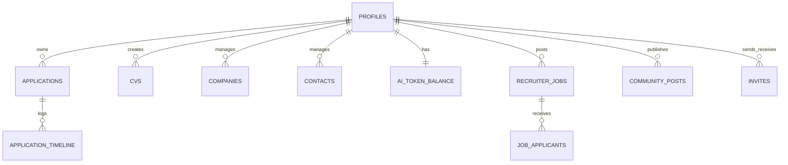

<div align="center">

# 🎯 HuntBoard — AI-Powered Job Search & ATS Platform

[](https://nextjs.org/)
[](https://react.dev/)
[](https://www.typescriptlang.org/)
[](https://tailwindcss.com/)
[](https://supabase.com/)
[](LICENSE)

**An intelligent, end-to-end recruitment management ecosystem for modern Software Engineers and Hiring Teams.**  
*Track applications with Drag & Drop Kanban, craft ATS-compliant resumes, benchmark skill match with AI, and discover talent with strict privacy controls.*

[Features](#-core-features) • [Tech Stack](#-tech-stack) • [Quick Start](#-quick-start) • [Database Architecture](#-database--security-architecture) • [Testing](#-testing--quality-assurance)

</div>

---

## ✨ Highlights

* 🧠 **AI Job Search Copilot**: In-browser ATS keyword matching, tailored Cover Letter generator, and encrypted BYO Key support (**OpenAI GPT-4o, Claude 3.5 Sonnet, Google Gemini**).
* 📋 **Interactive Kanban Pipeline**: Fluid multi-column Drag & Drop powered by `@dnd-kit` with Table view switcher and salary intelligence.
* 📄 **Structured CV Editor & PDF Engine**: Form-based ATS resume builder with 1-click printable PDF rendering (0-bloat typography).
* 👔 **Employer Portal & ATS-Lite**: Complete vacancy management, hiring pipeline stage transitions, and corporate domain verification.
* 🔒 **Candidate Privacy First**: Talents remain hidden from recruiters by default (`visible_to_recruiters = false`) with granular opt-in controls.
* 🌐 **Community Board**: Discover curated opportunities, interactive upvoting, and 1-click "Save to My Kanban" importer.
* 🌍 **Full i18n & Dark/Light Themes**: Dynamic locale switching across **English (EN)**, **Russian (RU)**, and **Polish (PL)** + smooth theme toggles.
* 💡 **Feedback & Bug Tracker**: Public roadmap queue with feature requests, severity levels, and admin triage console.

---

## 🚀 Core Features

### 1. 💼 Job Seeker Workspace
- **Dashboard & Funnel Analytics**: AI Hero Banner, conversion rate visualizer, upcoming interview alerts, and AI token monitor.
- **Kanban Board (`/applications`)**: Drag cards between 6 hiring stages (*Wishlist*, *Applied*, *Phone Screen*, *Technical Interview*, *Offer*, *Archived*).
- **CV Builder & Benchmark (`/cv`)**: Structured experience form, live preview, keyword match scoring, and PDF export.
- **Companies & Contacts (`/companies`, `/contacts`)**: Centralized relationship manager for recruiters, referral leads, and interview notes.
- **Interview Calendar (`/calendar`)**: Schedule technical rounds, add Google Meet / Zoom links, and set follow-up reminders.
- **Direct Invites Inbox (`/invites`)**: Review incoming interview invitations from verified recruiters with 1-click Kanban import.

### 2. 🏢 Recruiter Portal & ATS-Lite
- **Vacancy Manager (`/recruiter/jobs`)**: Create job postings with remote formats, salary brackets, and skill tag requirements.
- **Talent Discovery (`/recruiter/talent`)**: Search opt-in candidates by title, relocation readiness, and verified skill matrices.
- **Candidate Pipeline (`/recruiter/jobs/[id]/applicants`)**: Review applicant stages, inspect Cover Letters, and leave private hiring notes.
- **Company Verification (`/recruiter/verify`)**: Corporate domain email verification badge (*Verified Employer*).

### 3. 🌐 Social & Community Layer
- **Community Job Board (`/community`)**: Peer-shared vacancies with live upvoting, spam reporting, and instant Kanban import.
- **Feedback & Roadmap (`/feedback`, `/admin/feedback`)**: Submit feature ideas 💡, report bugs 🐛, and track engineering progress in real time.

---

## 🛠️ Tech Stack

| Layer | Technology | Purpose |
| :--- | :--- | :--- |
| **Framework** | Next.js 15.2 (App Router, Server Components) | Fullstack architecture & SSR/SSG routing |
| **Language** | TypeScript 5 (Strict Mode) | Zero runtime typing errors & strict schema typing |
| **Styling** | Tailwind CSS v4 + Radix UI + Lucide Icons | Ultra-fast token-based design system |
| **Database** | PostgreSQL + Supabase | 18 tables, automated auth triggers, & foreign key indexing |
| **Security** | Row Level Security (RLS) + AES-256-GCM | Isolated tenant data & encrypted user API keys |
| **State & Drag/Drop** | `@dnd-kit/core` + `@dnd-kit/sortable` | Smooth keyboard/pointer drag & drop Kanban |
| **Localization** | Custom React Context i18n Engine | Zero-dependency EN, RU, and PL translations |
| **Testing** | Vitest + Playwright Chromium | 19 unit/integration tests & 0-error browser audit |

---

## 🏁 Quick Start

### 1. Clone the repository
```bash
git clone https://github.com/Alex777x/huntboard.git
cd huntboard
```

### 2. Install dependencies
```bash
npm install
```

### 3. Setup environment variables
Copy the template file and add your credentials:
```bash
cp .env.example .env.local
```

Configure your `.env.local`:
```ini
# Supabase Configuration
NEXT_PUBLIC_SUPABASE_URL=https://your-project.supabase.co
NEXT_PUBLIC_SUPABASE_ANON_KEY=your-anon-key
SUPABASE_SERVICE_ROLE_KEY=your-service-role-key

# App URL
NEXT_PUBLIC_APP_URL=http://localhost:3000

# Security (32-byte secret for encrypting BYO AI keys)
AI_ENCRYPTION_SECRET=your-secure-32-byte-hex-key
```

### 4. Run the development server
```bash
npm run dev
```
Open **[http://localhost:3000](http://localhost:3000)** in your browser.

---

## 🗄️ Database & Security Architecture

HuntBoard relies on a hardened PostgreSQL schema managed via Supabase with **Row Level Security (RLS)** active on 100% of tables.



### Key Security Invariants:
1. **Seeker Isolation**: `auth.uid() = profile_id` ensures users can only read and mutate their own applications, resumes, and contacts.
2. **Opt-in Recruiter Visibility**: Candidates are hidden from `/recruiter/talent` queries unless `visible_to_recruiters = true`.
3. **AES-256-GCM BYO Keys**: User API keys are encrypted client-side with 12-byte IV and 16-byte authentication tags before transmission.
4. **Security Headers**: Production builds enforce `X-Frame-Options: DENY`, `HSTS`, `X-Content-Type-Options: nosniff`, and strict CORS policies.

---

## 🧪 Testing & Quality Assurance

Run the comprehensive automated test suite:

```bash
# Run Vitest unit and integration suites
npm test

# Run Next.js production build check
npm run build
```

### Test Coverage Highlights:
- ✅ **Voting Engine**: `src/lib/community/voting.test.ts`
- ✅ **Direct Invites**: `src/lib/recruiter/invites.test.ts`
- ✅ **AES-256 Cryptography**: `src/lib/ai/crypto.test.ts`
- ✅ **Kanban DnD Operations**: `src/components/applications/kanban.test.ts`
- ✅ **i18n Translation Completeness**: `src/lib/i18n/translations.test.ts`
- ✅ **CV Schemas & Feedback Types**: `src/types/cv.test.ts`, `src/types/feedback.test.ts`
- ✅ **Browser Audit**: 13/13 routes verified in Playwright with **0 console errors**.

---

## 🗺️ Roadmap

- [x] **Phase 1: Seeker Core MVP** (Kanban Board, Structured CV, PDF Export, AI Services)
- [x] **Phase 2: Recruiter Portal & ATS-Lite** (Job Vacancies, Talent Pool, Stage Pipeline, Direct Invites)
- [x] **Phase 3: Community, Feedback & i18n** (Community Board, Upvotes, EN/RU/PL Localization, Light/Dark theme)
- [ ] **Phase 4: Integrations** (LinkedIn Chrome Extension, Google Calendar Two-Way Sync, Telegram / Slack Webhooks)

---

## 📄 License

This project is licensed under the MIT License — see the [LICENSE](LICENSE) file for details.

<div align="center">
  <sub>Built with ❤️ by Anatoli Liaksandrou</sub>
</div>
